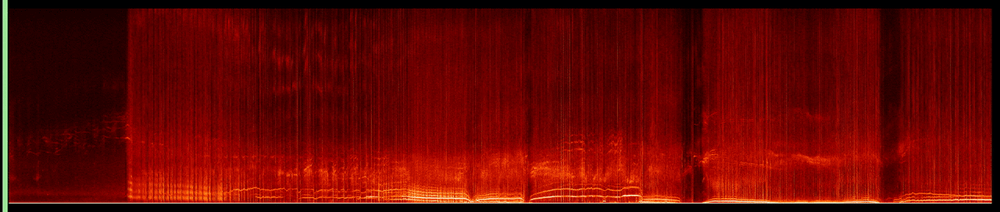

# TokEye

TokEye segments fluctuating signals in spectrograms, including coherent and transient activity. It works on raw time series or precomputed spectrograms and provides a Python API, a command-line interface, and a web app.

Start with [installation](getting-started/installation.md) and the [quickstart](getting-started/quickstart.md).

The default model returns two channels of scores between 0 and 1: coherent activity and transient activity. See [outputs](concepts/outputs.md) for interpretation and file formats.

Read the [TokEye preprint](https://arxiv.org/abs/2602.20317) or visit the [source repository](https://github.com/PlasmaControl/tokeye).
